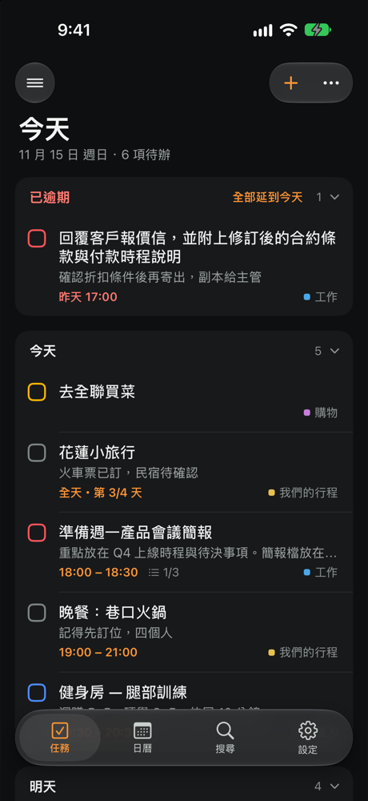
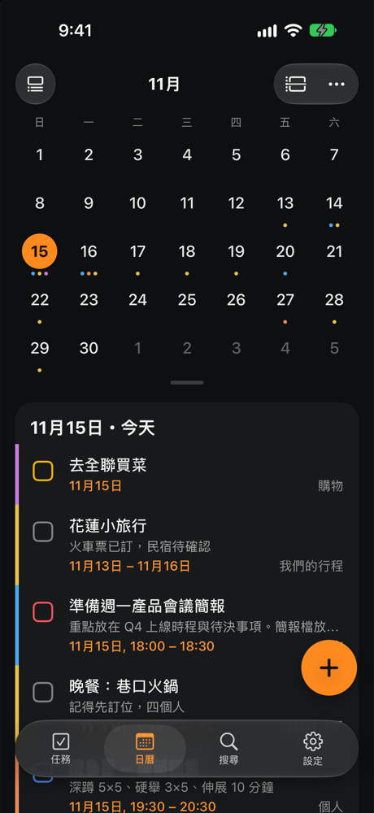
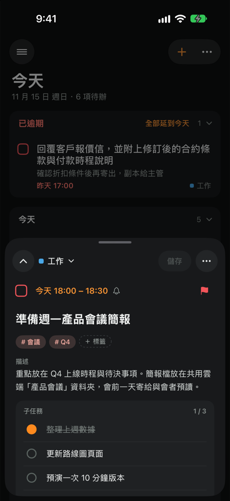
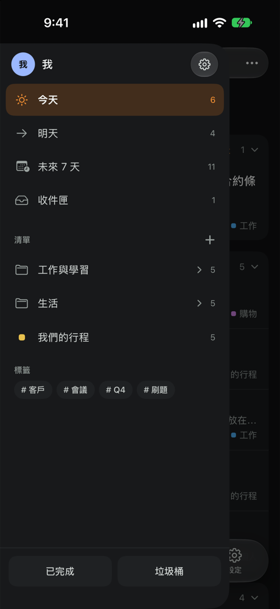

<p align="center">
  <picture>
    <source media="(prefers-color-scheme: dark)" srcset="docs/images/icon-dark.png">
    
  </picture>
</p>

<h1 align="center">DayDo</h1>

<p align="center">
  A to-do list and calendar in one iPhone app — local-first, built with SwiftUI.
</p>

<p align="center">
  
  
  
  
  
</p>

<p align="center">
  
  
  
  
</p>

DayDo puts your tasks and your schedule on the same screen. Every task can carry a date, a time block, reminders and a repeat rule, and shows up both in your lists and on the calendar. Interaction is inspired by TickTick. Everything is stored on the device first; multi-device sync and shared lists are in progress.

> [!NOTE]
> The app UI is currently in Traditional Chinese, and DayDo is distributed through TestFlight to a small private group only — there is no public download yet.

## Features

- **Today, Tomorrow, Next 7 Days and Inbox** smart lists, with overdue tasks grouped on top and one tap to move them to today
- **Lists and folders**, tags, priorities, subtasks and notes
- **Dates that behave**: all-day or timed tasks, time blocks, multiple reminders, and repeat rules (RRULE) — with time zones handled per task
- **Calendar** in list, year, month, week, 3-day and day views
- **Search** across titles, notes, tags and subtasks, plus Completed and Trash views
- **Shared lists** with members and assignees (works locally today; syncs once the backend ships)

## Status

| Phase | What | State |
| --- | --- | --- |
| 1 | Standalone app — all data in on-device SQLite | Done, in TestFlight |
| 2 | Sync & sharing — sign-in, multi-device sync, shared lists, assignees | In progress |
| 3 | MCP server — let AI assistants read and write your tasks | Planned |

Also on the list: home-screen widgets and a macOS version.

## How it's built

```
DayDoCore/   Swift package: models, SQLite (GRDB), the DayDoAPI command layer,
             date / recurrence / reminder logic
ios/         SwiftUI app (iOS 26+), project generated by XcodeGen
server/      Sync backend: Cloudflare Workers (Hono) + D1 + Durable Objects
spec/        openapi.yaml (HTTP contract), sync.md (sync protocol), shared fixtures
design/      Design mockups
```

A few choices that shape the code:

- **One API, three clients.** The UI never touches the database; every read and write goes through `DayDoAPI`. The local implementation, the sync Worker and the future MCP server all speak the same contract defined in [`spec/openapi.yaml`](spec/openapi.yaml).
- **Built for sync from day one.** IDs are client-generated UUIDv7, deletes are soft, and every write appends to an outbox in the same transaction. Ordering uses fractional indexes, so reordering never renumbers rows.
- **Server-side consistency.** Each user's data lives in its own Durable Object with transactional SQLite; merges are ordered by a hybrid logical clock. See [`spec/sync.md`](spec/sync.md) for the full protocol.

## Building

Requires Xcode 27 (iOS 27 SDK), [XcodeGen](https://github.com/yonaskolb/XcodeGen) and Node.js.

```bash
# Core library tests
cd DayDoCore && swift test

# iOS app
cd ios && xcodegen generate && open DayDo.xcodeproj

# Sync backend: type check, unit tests and local end-to-end tests
cd server && npm ci && npm run check
```

Debug launch arguments: `-DayDoDemo` loads sample data, `-DayDoReset` wipes local data, and `-DayDoScreen <name>` opens a screen directly (`calendar`, `detail`, `search`, `settings`, …).
